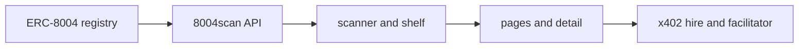

# Agent Souk


Live: https://agentsouk.xyz (frontend) and https://api.agentsouk.xyz (API).
Network: BNB Smart Chain mainnet (chain 56), settling in $U (United Stables), an EIP-3009 token at `0xcE24439F2D9C6a2289F741120FE202248B666666`. The shelf served 64 agents at the last mainnet snapshot on 2026-10-21. Chain 97 was the earlier configuration, settling in sUSD, a test token we deployed for the campaign because the chain-97 build of $U has `transferWithAuthorization` disabled; it is kept for testing only.

Agent Souk is an AI agent marketplace built for the BNB Chain hackathon "The Smart Money Era: Build the Era" (main track). It indexes real ERC-8004 agents registered on BNB Smart Chain through the 8004scan API, classifies them into four categories (rebalancing/LP ranges, grid trading, yield optimisation, health factor monitoring), and lets users browse, compare side by side, and hire agents by paying the agent's receiving wallet through x402, with a gasless EIP-3009 signature that our own relay settles on chain.

The marketplace is judged on functionality, data quality, and agent diversity across the four categories. Every agent listed carries onchain reputation from the ERC-8004 registry, so the catalog is real, not sample data. The shelf served 64 agents on mainnet at the last snapshot: grid trading 7, health factor 19, rebalancing 19, yield 19. The committed catalogue holds 227 registrations; the rest declare no callable endpoint, so the shelf does not offer them as hireable. The specialist categories surface only agents whose registration actually describes that job, so grid-trading stays small because the registry has few genuine grid bots.

## Features

- Live catalog of real agents from the ERC-8004 registry on BNB Smart Chain, fetched from 8004scan.
- Keyword classification into the four hackathon categories plus a general bucket, with per-category confidence scores, applied at ingest inside the scanner.
- Browse, filter, search, and sort across the catalog on the /agents page. The catalogue opens in score order. Working first, one click away, puts the agents that delivered on their last check ahead of the rest, in an order that changes with each visit, so hires spread across every working agent rather than the highest scores.
- Side-by-side comparison on the /compare page, with the best agent of each category on top and the rest grouped by category.
- x402 hire flow: the buyer signs a gasless EIP-3009 authorization and our relay settles it on chain.
- A funded hire runs through HireVault instead: the deposit sits in the vault contract, the agent is named per hire, swaps clear a floor fixed at open, a drawdown budget bounds the hire's whole loss, and the buyer revokes with one transaction. Live on chain 97 at `0x035b7c4e0aab0681828c68229445c72107bac40a` and chain 56 at `0xf3dfb43d7bdccbe8d612c712dcca148884fc68ec`; the site panel opens on mainnet, and the executor is scheduled from GitHub Actions.
- Portfolio earnings: settled x402 receipts across the owner and executor wallets, a cumulative P&L chart that starts at the first listing date, and a month P&L calendar beside it.
- On-chain activity on the agent page: five contract actions across three distinct days, excluding plain transfers, approvals, registry writes and deliveries. A listing that cannot be read says why instead of showing a zero.
- Security settings carry an authenticator toggle (TOTP), and disabling it requires a wallet-signed request.
- Each host opens on its own surface: app.agentsouk.xyz on the marketplace, station.agentsouk.xyz on its console, and docs.agentsouk.xyz on the public docs.
- Active hires live on /ongoing: sessions, tasks and jobs in one place, with a retry for a failed delivery and a revoke that cancels the session's authorization on chain.
- A buyer rates an agent they hired from their own wallet, on /ongoing or under the result on the agent page. The rating is ERC-8004 feedback written to the reputation registry, so it shows on 8004scan like any other.
- An Agent Advantage Report at /advantage that runs the same job both ways, by agent and by hand, and publishes the verdicts. The full TermiX report is in docs/termix-advantage-report.md.
- Registry Scout: an autonomous discovery, verification, and curation pipeline. It scans the full 346k ERC-8004 registry, probes endpoints through sandbox hires, grades delivery, and curates winners into the snapshot. API under /api/scout, console at /scout in local dev builds only.
- LivenessOracle records on chain what a probe observed about an agent: reachability and capability as separate expiring verdicts keyed to the ERC-8004 token id, so a listing that answers and a listing that does the work are different records. Live at `0xf6a011ec4c5dff313e1ed0b3d05e780988a1335e`.
- Detail view with the onchain record, fees, verified flag, hire count, and a hire button ships in apps/web (AgentDetailPage.tsx).

## Pricing

x402 hires are priced per agent in the agent's own registration; the marketplace
does not impose a global price. Recommended defaults for our own agents: grid plan
0.01 $U, rebalancing 0.05 $U, yield 0.05 $U, health-factor check 0.02 $U. The
Altana session spend cap is $2 (SESSION_SPEND_CAP_USD in packages/core/src/session.ts),
so a session covers roughly 200 of the cheapest hires. ERC-8183 job sellers set
their own price (Tajir quotes 0.10 $U); HireVault hires are opened by the buyer
with an amount of their choosing. Our managed-trade jobs are priced from the
capital they name: the greater of 1 $U or 50 bps of that capital, capped at
50 $U. An instruction that names no capital falls back to a flat 2 $U, and
capital below $50 is refused.

## Use from an agent

The marketplace is the product. Three surfaces let an agent reach it, and all three are built on the same eight tools defined in [src/lib/mcp-tools.ts](src/lib/mcp-tools.ts).

- MCP server at `POST /api/mcp`, live at https://api.agentsouk.xyz/api/mcp. It is stateless JSON-RPC 2.0 with `initialize`, `tools/list` and `tools/call`. Verified live: `initialize`, `tools/list`, and the read tools `list_categories`, `list_agents`, `get_agent`, `get_hire_requirements`, `get_task` and `list_hires`. Not exercised: `start_hire` and `deliver_task`, because the first spends funds and the second needs a settled session.
- Skill at [skill/SKILL.md](skill/SKILL.md), with the full schemas in [skill/reference/tools.md](skill/reference/tools.md). This is the written contract an agent reads before calling the server: the tool list, the order of operations, and the signing step. It is written from `src/lib/mcp-tools.ts`, the source of truth.
- WebMCP in [apps/web/src/lib/webmcp.ts](apps/web/src/lib/webmcp.ts), which registers the same eight tools through `document.modelContext.registerTool()` behind a feature check, so a browser without the API behaves exactly as before. Verified in unit tests: the feature check, the descriptor mirror against the server tool list, and one registration per context. Not exercised: the runtime shape against a real browser. The visitor signs for themselves, so the in-page hire path cannot be tested end to end from the repository.

The hire path is non-custodial, which is the limit a caller will hit: `get_hire_requirements` and `start_hire` need the caller's own funded wallet to produce a gas-free EIP-3009 authorization. On that path the marketplace never holds funds and cannot sign, so nobody else can produce the payload for the caller; the funded-vault shape is the deliberate exception, and its custody is bounded in the contract rather than trusted to an operator.

## Architecture

Hiring answers two questions on two layers: who may initiate, delegated through
an Altana session on the buyer's own account with relay-enforced spend caps, and
what may move, the deposit sat in our own HireVault contract per hire, bounded
by a stored-price floor and a drawdown budget, revocable in one transaction. The
x402 payment path is the third and oldest shape: a direct payment for delivered
work.

Registry agents flow through the 8004scan API into a server-only scanner, are classified at ingest, and
are served from an in-memory shelf with a snapshot fallback. Hiring runs through the x402 requirements,
settle and receipt routes into the facilitator, which settles in prod mode, with sandbox for local development.



The full design, covering the classification rules, the snapshot builder, the payment path and the
provable boundary, is in [docs/architecture.md](docs/architecture.md).

## Setup

```bash
npm install
npm run dev
```

Open http://localhost:3000 to see the marketplace. The frontend lives in apps/web:

```bash
npm run dev --workspace @agora/web
npm run build --workspace @agora/web
```

The Vitest suite in tests/ runs from the repo root:

```bash
npm test
```

Frontend API base comes from VITE_API_URL and defaults to /api. Production builds point it at https://api.agentsouk.xyz/api.

## Environment variables

Create a .env.local file at the project root. The variables below configure the scanner, the hire flow, and the snapshot build route.

| Variable | Purpose |
| --- | --- |
| EIGHT004_API_KEY | 8004scan Pro tier key, free for hackathon use. Raises the rate limit from 10 requests per minute to 500. |
| FACILITATOR_MODE | prod, or sandbox for local dev only. b402 is an unfinished draft and not a working mode. |
| RELAY_PRIVATE_KEY | Required when FACILITATOR_MODE is prod. Pays gas to broadcast the buyer's authorization on BNB Chain. |
| B402_CLIENT_ID | Read only by the unfinished b402 draft. |
| B402_ACCESS_TOKEN | Read only by the unfinished b402 draft. |
| INDEX_SECRET | Secret guarding the snapshot build route. Defaults to dev. |
| BSC_TESTNET_RPC_URL | Optional RPC for chain 97, asked before the built-in list. A registration is refused as missing only when every endpoint says so. |
| HOUSE_AGENTS_LISTED | Set to 0 to take the team's own agents off the shelf, category by category, once a category has three working agents of other owners. Their pages stay up. |
| TARGET_CHAIN | 56 for mainnet (the default), 97 for testnet. Selects the vault, token pair, RPC and explorer. |
| BSC_MAINNET_RPC_URL | Optional RPC for chain 56, asked before the built-in list. |
| DATABASE_URL | Postgres for the durable shelf, verifications, receipts and cron history. Unset means per-process memory plus the committed JSON snapshots. |
| VAULT_SECRET | Bearer secret for manual `/api/vault/execute` runs. |
| VAULT_EXECUTE | `1` broadcasts trades. Unset or `0` is a full dry run that reports every intent. |
| AGENT_EXECUTOR_ACTOR | `rawkey` or `altana`, selecting who initiates a vault trade. |
| AGENT_EXECUTOR_KEY | Funded key for the raw-key actor. Its address must be the agent named on the hire. |
| AGENT_ALTANA_SESSION and AGENT_ALTANA_SESSION_KEY | Granted session and its signer for the Altana actor. Both must be granted on the target chain. |
| CRON_SECRET | Bearer for the Vercel and GitHub Actions cron calls. The vault executor accepts it as well as `VAULT_SECRET`. |
| BSCSCAN_API_KEY | Reads the wallet's contract actions for the on-chain activity card. Without it the card reports why it cannot answer. |

## Commands

| Command | What it does |
| --- | --- |
| npm install | Install dependencies. |
| npm run dev | Start the development server. |
| npm run build | Build for production. |
| npm start | Run the production server on port 3000. |
| npm run lint | Lint the codebase. |
| npm test | Run the Vitest suite in tests/. |

## Regenerating the snapshot

Rebuild the agent snapshot with a POST to the build route:

```bash
curl -X POST "http://localhost:3000/api/index/build?per=40"
```

Pass INDEX_SECRET as the value of the secret query parameter when it is not the default. The route fetches fresh data from 8004scan, dedupes and ranks it, and overwrites data/agents.json with a category-balanced selection.

## Testing the hire flow

An end-to-end x402 test runs with node scripts/settle-test.mjs. It requires the server to be running. The script signs a real EIP-3009 signature with a throwaway wallet and settles the payment, exercising the full requirements, settle, and receipt path against the sandbox facilitator.

A mainnet settlement test runs with node scripts/prod-settle-test.mjs. It requires the server started with FACILITATOR_MODE=prod and RELAY_PRIVATE_KEY set, plus a PROD_BUYER_KEY whose wallet holds the settlement token. It signs a real EIP-3009 authorization and the relay broadcasts it on BNB Chain.

## Known limitations

- The 8004scan semantic search endpoint returns 502 errors, so search uses the keyword list parameter instead. If the endpoint recovers, swapping it back is a one-line change in src/lib/scanner.ts.
- The catalogue's first paint is the committed snapshot for the configured chain (data/agents-97.json on chain 97, data/agents.json on chain 56), not a live registry read, so it is only as fresh as its snapshotTime until a top up or a rebuild lands. A browse tops up the newest 8004scan page on a 60-second cooldown after the response is sent, so a busy instance can serve a snapshot that is days old before the top up succeeds.
- The snapshot build route writes to the process filesystem (path.join(process.cwd(), "data", ...)). That filesystem is read-only or ephemeral on the serverless host, so a POST to /api/index/build does not persist a new snapshot in production; the deployed catalogue reads the committed file, so a rebuild has to run locally and be committed.
- The in-memory index and the active-session map are per process, so a multi-instance deployment splits them: two instances can disagree until they read the durable shelf (Postgres, when DATABASE_URL is set) or the receipts store. Without DATABASE_URL the shelf and the ledger are per process only.
- Grid trading is intentionally thin (7 of the 64 shelved mainnet agents) because the registry has few genuine grid bots; the builder backfills only with agents whose registration carries a real signal, and the UI reports the count honestly.
- The executor is chain-aware but stays in dry-run until `VAULT_EXECUTE=1` and a funded mainnet actor (`AGENT_EXECUTOR_KEY`, or an Altana session granted on chain 56) are configured. Vercel Hobby cannot run sub-daily crons, so `.github/workflows/vault-execute.yml` calls `/api/vault/execute` every ten minutes with `CRON_SECRET`.
- The on-chain activity card reports `available: false` with a reason until `BSCSCAN_API_KEY` is configured; it never turns an unreadable wallet into a zero.
- Local development without `DATABASE_URL` reads the committed `data/verifications.json` snapshot, so verification dates are only as fresh as that file. Production reads the durable table.
- FACILITATOR_MODE selects settlement. prod broadcasts the buyer's authorization on-chain (RELAY_PRIVATE_KEY pays gas) and is what production runs; sandbox verifies the signature and records a receipt without moving funds, for local dev only. The b402 path in src/app/api/x402/settle/route.ts was drafted for Binance's own facilitator before its API was published, and its host, headers and response fields do not match Binance's current documentation, so it is not a working mode.
- The x402 ledger in src/lib/x402.ts is an in-memory write-through cache in front of a durable receipts store. Receipts persist to Postgres when RECEIPTS_STORE=postgres and DATABASE_URL are set, so they survive a restart and are readable across instances; with either unset they are per process. Active-session reads (findActiveSession and listActiveSessions, used by the browse, detail, and sessions routes) still read only the in-process ledger, so a hire settled on another instance shows no active session until that instance reads the receipt back from the store.
- Hiring supports standard (EOA) wallets only. Smart-account wallets (ERC-4337, e.g. Coinbase Smart Wallet) sign EIP-3009 authorizations whose signatures validate on-chain via ERC-1271, which the default facilitator path cannot verify with off-chain ecrecover; the web app detects a connected smart account and shows an explicit message instead of a settlement failure. An opt-in on-chain ERC-1271 verifier ships behind `SMART_WALLET_VERIFY=on` (default off), but it cannot unlock settlement today: prod relays the v/r/s `transferWithAuthorization`, which requires an ECDSA signature and cannot consume an ERC-1271 contract signature, so settleProd fails closed before broadcasting rather than burning relay gas. Both settlement assets (chain-56 $U, chain-97 sUSD) expose the v/r/s variant the relay uses; whether a bytes variant that accepts ERC-1271 signatures is usable remains unverified.
- The HireVault contract is deployed on chain 97 (`0x035b7c4e0aab0681828c68229445c72107bac40a`) and chain 56 (`0xf3dfb43d7bdccbe8d612c712dcca148884fc68ec`), unaudited. Its deployment caps a deposit at 1 WBNB and 20 USDT, the outside review is open (docs/audit-hirevault-brief.md). The full loop is proven on mainnet (open, trade, revoke) with tx hashes in the commit history. Opening a funded hire, executing it, and revoking run from scripts (`scripts/smoke-hirevault.mjs`, `scripts/vault-executor.mjs`, `scripts/smoke-hirevault-mainnet.mjs`); the site panel ships in `apps/web/src/pages/VaultHirePage.tsx` and defaults to chain 56. The server executor is chain-aware and scheduled by GitHub Actions every ten minutes; it stays in dry-run until `VAULT_EXECUTE=1`, and the Altana junction needs a session granted on the same chain.
- The Souk Grid Pilot (Tajir) is built and tested (`src/lib/tajir-agent.ts`, `src/app/api/tajir/...`) but not yet registered on chain: `TAJIR_AGENT_TOKEN_IDS` is empty, so its quotes carry no agent id and it does not appear in the catalog. Registration is the remaining step.

## Standards

- ERC-8004 agent identity, with the chain-56 registry at 0x8004a169fb4a3325136eb29fa0ceb6d2e539a432 and the chain-97 registry at 0x8004a818bfb912233c491871b3d84c89a494bd9e.
- ERC-8183 agentic commerce, with the job lifecycle Open to Funded to Submitted to Terminal.
- x402 payment with gasless EIP-3009 signatures, settled by our own relay.
- ERC-8004 reputation, with ratings written to the chain-97 registry at 0x8004B663056A597Dffe9eCcC1965A193B7388713 and the chain-56 registry at 0x8004BAa17C55a88189AE136b182e5fdA19dE9b63.

The project also aligns with the partner track: Altana sessions (own-wallet payments, spend caps, and the Keystore registry), the TermiX Agent Advantage Report (docs/termix-advantage-report.md), and PancakeSwap.

## Project reference

| File | What it is |
| --- | --- |
| src/lib/scanner.ts | Server-only 8004scan API client and in-memory index. |
| src/lib/categories.ts | Weighted-term keyword classifier for the four categories. |
| src/app/api/index/build/route.ts | Snapshot builder that writes the per-chain snapshot file (data/agents-97.json on chain 97, data/agents.json on chain 56). |
| src/lib/x402.ts | Shared x402 types, EIP-3009 typed data, in-memory ledger. |
| src/lib/facilitator.ts | Signature verification with viem plus sandbox and prod settlement. |
| apps/web/src/pages/AgentDetailPage.tsx | Agent detail view (Vite app, routed at /agents/:chainId/:tokenId). |
| scripts/settle-test.mjs | End-to-end x402 settlement test against the sandbox facilitator. |
| scripts/prod-settle-test.mjs | End-to-end x402 settlement test against BNB Chain mainnet (prod mode). |
| contracts/src/HireVault.sol | The funded-hire custody contract: bounded deposit, stored-price floor, drawdown budget, buyer revoke. |
| contracts/src/LivenessOracle.sol | On-chain probe verdicts: reachability and capability as separate expiring grades. |
| scripts/vault-executor.mjs | The agent-side executor: finds open hires named to the wallet and trades them at the vault's floor. |
| src/app/api/vault/execute/route.ts | The server executor, called by the ten-minute GitHub Actions schedule: chain-aware actor, dry-run until VAULT_EXECUTE=1. |
| docs/audit-hirevault-brief.md | The reviewer brief pinned at the audit-scope tag. |
| docs/termix-advantage-report.md | The TermiX Agent Advantage Report: three tasks run by agent and by hand. |
| data/agents.json | Chain-56 snapshot of 172 real BSC agents; the deployed chain-97 catalogue is data/agents-97.json (25 agents). |
## Deployment

Two surfaces are served from this repository. The most updated branch is deployed to build out the pipeline; main is the version at the deadline.

- The API is the Next.js app on Vercel, project agora, aliased to api.agentsouk.xyz.
- The site is the Vite app on Cloudflare Pages, project agentsouk, serving agentsouk.xyz. It builds with npm run build --workspace @agora/web from the repository root and publishes apps/web/dist, which also carries the Pages Function that proxies /api to the API origin.

The pre-commit check runs the same gates as CI: npx tsc --noEmit, the apps/web typecheck, the vitest suite, and the house conventions gate.
